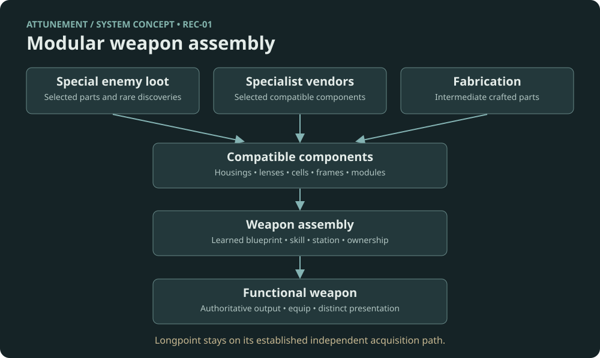
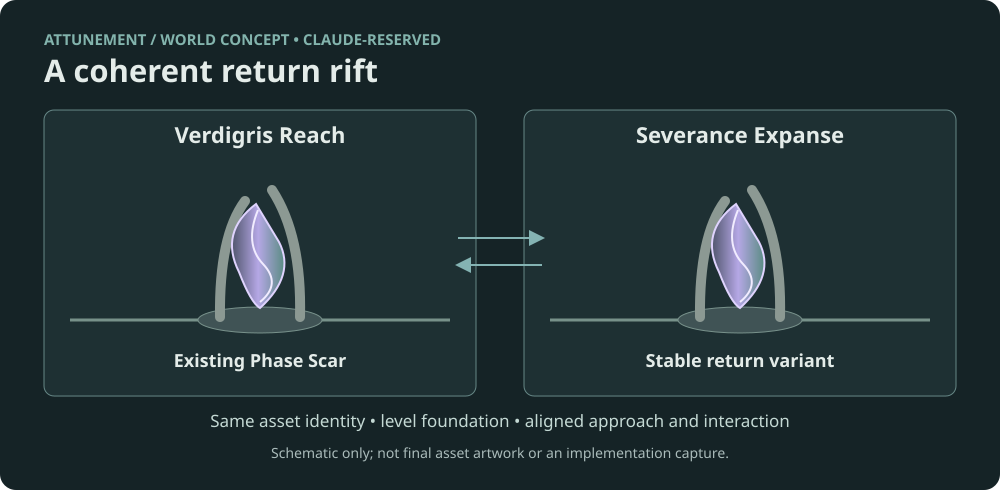

# ATTUNEMENT — Development roadmap and delivery register

## Cinematic Character Selection and World Entry — 2026-11-20

See [the complete owner-directed cinematic selection delivery roadmap](art/CINEMATIC-CHARACTER-SELECTION-ROADMAP.md) and [the original composition blueprint](art/concepts/cinematic-character-selection.svg). An isolated branch replaces the rejected beige/gray selection treatment with full-viewport cold material architecture and a live **persisted** gameplay model. Reuses authoritative account/character ownership, six-slot limit, character creation/initiation, deletion and world-entry contracts. Account-only projection now includes supported equipment visuals and true character-owned metadata. Focused validation is added; runtime screenshots, GPU profiling, full race/equipment visual acceptance, and PR checks must be verified before production promotion. Keep Expanse/Silent Foundry owner-isolated.

Owner direction, 2026-11-18. Baseline: main after audit PR #68. Read [Implementation audit](IMPLEMENTATION-AUDIT-2026-11-18.md), [Game concept](Attunement-Game-Concept.md), [AGENTS.md](../AGENTS.md), and [playtest validation](PLAYTEST-VALIDATION.md). This is the public, high-level execution register explicitly requested by the owner; private encounter scripts, undiscovered triggers, exact loot odds, unreleased assets and other sensitive production information are excluded. Status is evidence-based: **present** means source implementation exists, **partial** means unfinished/limited, **outstanding** means not complete, **branch only** means not integrated, **deferred** specifies sequencing, and **verify** requires current integrated evidence.

## 1. Objective and authority

Build a coherent, persistent MMORPG where character choices, exploration, combat, companions, loot, equipment, fabrication, vendors, quests and discoveries reinforce one another. Do not equate merged code, prototype mechanics or concept artwork with a finished player experience. Preserve existing functionality, saves, established lore and original art identity. The current priority is gameplay usability, interaction and systems coherence; broader content expansion follows that milestone, not the reverse.

Owner approval: routine development, push to focused topic branches, validation and merge are authorized once applicable Actions pass on the correct current integration result and no material warnings, errors or concerns remain. Use small, independently verifiable increments; never bypass validation, force-push shared history, fabricate evidence, waive real failures or publish unlicensed assets. A green test suite does not establish artistic quality, economy balance, performance or human play acceptance. Mark each separately. If blocked, retain a coherent checkpoint; diagnose before rerunning. Main is canonical.

## 2. Reconciliation and existing-system verification

| ID | Work | Baseline / status | Acceptance |
|---|---|---|---|
| INT-01 | Audit all branch heads, PRs, plans and integration status | Audit merged in #68; 70 original heads, 67 original PRs, ten non-ancestral heads | Reconcile deltas selectively, preserve history; avoid wholesale historical merges. |
| INT-02 | Pointer-lock steering, skitter readability, rig guard and capture | Merged #66; verify human play and visual quality | Fresh integrated checks; correct pending-lock failure, cancellation and release behavior; real-input browser coverage; distinguish visual review. |
| INT-03 | Recover isolated character appearance work | charlie/character-appearance, branch only | Inspect schema, saves, client/network, capture pipeline and conflicts; port validated increments, not obsolete tree. |
| INT-04 | Historical branch retention | Audit identifies eight further non-ancestral heads | Compare unique behavior/diffs and current tests; classify superseded, retained or genuinely missing. |
| INT-05 | Verify advanced fabrication/fusion and QL5 weapon progression | Present #53–56 | In-game acquisition/requirements, station and skill gating, irreversible costs, valid/invalid actions and persistence. |
| INT-06 | Verify metaphysical abilities | Partial; Keeper Phase Transposition only | Correct labels/availability, unlock visibility, authoritative cast and cost behavior. |
| INT-07 | Verify ground navigation and Survey Strider | Present/partial #57–58 | Follow/assist/stay, obstacle handling, ownership, deployment, dismissal, reconnect and real traversal. |
| INT-08 | Verify Phase Scar and Residual Traces NPC quests | Present but incomplete #60–62 | Real navigation, meaningful outcome, quest journal and reward consistency. |
| INT-09 | Verify layered VFX | Present #59/#62 | Real cast evidence, readability, motion settings, budget and cleanup. |
| INT-10 | Verify maintenance kits, Field Recovery and archival relics | Present #63–65/#67 | Acquisition/consumption, mastery, owner-isolated loot, replay/storage limits and persistence. |
| INT-11 | Verify player systems | Present/partial | Account/roster, party/minimap, companion sheet, combat/cover/corpse lifecycle, radio, vendor, inventory and journal; retain valid behavior. |

## 3. Milestone A — Gameplay usability and interaction (first)

| ID | Work | Baseline / status | Acceptance |
|---|---|---|---|
| UX-01 | Character glow and Seen acknowledgement | Implemented and automated integration passed #77; human play review remains | Character only reflects relevant equipment; hover/focus actual item records persistent Seen; no false glow for materials, no stale-sheet reappearance or cross-character leaks; genuinely new acquisition still glows. |
| UX-02 | F opens manual loot, next independent F Takes all | Implemented and automated integration passed #77 | Current visible corpse session takes priority; held-key repeat does not collect; auto-loot and Shift+F manual override, individual choice, capacity, range and owner isolation remain. |
| UX-03 | Reusable panel/window manager | Workshop implementation and integration passed #77; selective extension outstanding | Move, resize with limits, lock/unlock, surface opacity independent of text, persisted position/size/preferences, restore defaults, viewport clamping, keyboard accessibility; begin Workshop, extend selectively. |
| UX-04 | Fabrication visibility | Implemented visibility/cancel integration #77; human play review remains | Accepted production closes Workshop; independent compact progress/cancel; failure leaves understandable UI; completion notification, no auto-reopen; preserve batch state. |
| UX-05 | Character ritual presentation | Partial; local panel dismissal integrated #77; visual acceptance outstanding | On confirmed inscription/installation/upgrade, unobstructed local character view; relevant panels dismiss/minimize, no remote-player effects altering local UI; cancellation/error intelligible; authoritative attributes/delta notification. |
| UX-06 | Listening Stone motion | Cast motion tuned on #115; in-world review pending | Preserve angular integration and idle/proximity behavior; tune cast movement initially +25–35%, assess actual animation, reduced-motion and readability. |
| UX-07 | Explain equipment/attunement and metaphysical powers | Partial | Show class/ability prerequisites, acquisition sources and hotkeys without revealing undiscovered content. Clear distinction between general and profession-specific powers; no nonfunctional controls. |
| UX-08 | Kinetic coupler and material discoverability | Implemented contextual navigation and automated integration passed #77 | Contextual Used in for known compatible recipes, quantity and requirements, direct Workshop navigation; no spoiler of undiscovered recipes; explain how to discover more. |
| UX-09 | Quest Journal rewards | Listed rewards merged #71; actual grant history outstanding; XP-cap refresh candidate #81 | Show authoritative player-visible rewards (XP, credits, items/materials/knowledge/unlocks where applicable) before turn-in and actual granted outcomes afterwards. Conditional/choice/unknown rewards labeled appropriately; no fictional rewards or spoilers; capped XP clearly distinguished; journal and NPC agree. |
| UX-10 | Interaction consistency and onboarding | Partial; arrival hall and model comparison on #115 | Explain actual controls and next achievable goals in context; remove misleading placeholders or mark unavailable; identify and test quest-to-reward-to-equipment-to-combat loops. |
| UX-11 | Equipment navigation and notifications | Partial | Distinguish new equipment vs inventory; direct contextual actions, reversible UI settings, accessible focus and small-screen behavior. |
| UX-12 | Workshop/NPC material usage guidance | Branch only #78; integrated validation pending | Crafting and research NPC introduction, first achievable recipe and station explanation; existing dialogue/quest system rather than competing tutorial framework. |

Milestone A exit: actual integrated browser evidence for acquisition/Seen, corpse loot, material-to-recipe navigation, crafting, ritual and quest-reward presentation. No regression of original controls, saves or authority. Confirm usability with human play when available; record limitations.

## 4. Milestone B — Systems coherence and meaningful gameplay

| ID | Work | Baseline / status | Acceptance |
|---|---|---|---|
| SYS-01 | Dedicated anatomical equipment placement | Partial, four authoritative slots | Define purposeful device, glyph, implant and weapon placement/compatibility; distinct installation methods and effects; multi-slot loadouts, migration of legacy saves, authoritative eligibility, dependency/cascade and removal tests. Avoid cosmetic-only fake slots. |
| SYS-02 | Recipe acquisition | Partial | Random recipe drops plus appropriate merchants/quests/research; persistent learned state, duplicate behavior, discovery-safe UI, server-only outcomes, no progression deadlocks. |
| SYS-03 | Credit loot and economy | Partial | Server-owned personal credit drops, caps, one-time collection, replay/ownership checks; tune buy prices against observed earning rate, repairs, crafting and consumable sinks; no arbitrary inflation, avoid impossible starter progression. |
| SYS-04 | Social clothing at vendor | Outstanding | Purchasable cosmetic inventory and actual equippable social slots, preview and clear price; visible model change, persistent independent cosmetic loadout with no unintended stat effects; validate ownership, costs, duplicates and legacy saves. |
| SYS-05 | Phase Scar meaningful purpose | Traversable Annex and persistent reward on #115; browser and balance acceptance pending | Communicate reason and goal; meaningful success and failure, progress/recovery or discovery even at level cap, authoritative lifecycle and reward integrity, no repeat exploitation. |
| SYS-06 | Traversable rift prototype | Three chambers and return travel on #115; integrated browser acceptance pending | Consider at least one rift that leads to a separate room, world or realm with monster encounters. A bounded encounter-space prototype first; explicit entry/exit/return, death/reconnect/party ownership, server-controlled spawn, rewards and cleanup, safe fallback. Do not claim an actual second universe from a cosmetic teleport. |
| SYS-07 | Metaphysical discovery | Partial | Discoverable abilities beyond a single class-specific addition; distinguish class abilities, glyph alterations and attunement-derived powers; reliable progression, visible requirements and coherent build choices. |
| SYS-08 | Improve Brine Surveyor | Partial | Assess play rhythm, meaningful actions, distinctive utility, companion interaction, encounter applicability and progression; improve actual experience rather than numerical reskin. |
| SYS-09 | Crafting professions and economy | Partial; production XP and progression on #115, balance pending | Build from Engineering, Research and Field Recovery; useful recipes and materials, NPC introduction, progression and interplay; avoid duplicate crafting engines. |
| SYS-10 | Rewards/loot consistency | Partial | Connect quest, rare/very rare tokens, loot, vendors and fabrication; reward explanations, storage, fairness, replay and persistence; balance with actual gameplay. |

Milestone B exit: player can understand and use rewards, construct a differentiated build, discover meaningful content, gain/spend credits and complete a Phase Scar activity. Test cross-system authority and economic abuse cases; measure play balance, do not disclose hidden rates.

## 5. Milestone C — Identity and visual quality

| ID | Work | Baseline / status | Acceptance |
|---|---|---|---|
| ART-01 | Serious original science-fiction weapon families | Partial; current models not accepted | Use AO as visual reference only. Credible proportions, receivers/barrels/emitters, grips and mounts, material wear, class distinctions, QL variation and readable silhouette; no toy-like aesthetic. Inspect full model, equipped pose, motion, LOD, performance and provenance. |
| ART-02 | Race/body appearance recovery | #73 merged; body-frame comparison and durable in-world editing on #115, visual acceptance pending | Review existing Colonist/Veyran/Mirekin schema, frames, face/skin/hair, headgear and save rules; correct clipping and detached hair; actual character creation and live network appearance. |
| ART-03 | Distinct race skeletons and faces | Deferred/partial | Distinct mature silhouettes and anatomy with animation/attachment compatibility; incremental rigging and verified live animation; not recolors or concept art presented as working models. |
| ART-04 | Class clothing and headgear | Partial | Weathered coherent material/shape language, social-vs-combat outfit separation, faces visible where appropriate, no clipping; preserve class readability. |
| ART-05 | Companion visual fidelity | Strider GLBs and live distance detail implemented on #115; visual acceptance pending | Mender and Strider silhouette/material/motion; use proven rig pipeline; separate new species by actual mechanics. |
| ART-06 | VFX and environments | Partial | Preserve original authored libraries, layered effects, terrain/industrial kit, ecology and readability; validate in context not just asset previews. |
| ART-07 | Review prior 15 deliverables and 19 visual reviews | Partial; 56 vector item portraits rendered for review, final in-context review pending | See art/ASSET-PRODUCTION-PLAN.md and art/reviews; verify actual in-game usage, not just file presence; reference archive remains incomplete. |
| ART-08 | Asset sourcing and licensing feasibility | Investigated; AO direct reuse blocked absent permission | See section 7. Prefer legally reusable donors and original adaptation; no ripped models. |

| ART-09 | Halo Construct NPC race (wardens, vendor) | Merged (#122, browser e2e in CI): four outward-facing Sanctum Wardens and the quartermaster as the Halo vendor, from the accepted source via the asset pipeline's `imported-mechanical-humanoid` route; technical validation recorded in art/HALO-CONSTRUCT-NPC.md. 2026-11-21: the vendor moves to the guard body and vertical ring, painted white and ebony, with a blue sash only (the horizontal-ring vendor read as deformed) | Preserve accepted anatomy, open ring and optics; distinct security/vendor wardrobes; rigid shells, flexible couplings; exactly four outward wardens outside the perimeter; vendor services unchanged; actual GLB in game. Further roles (artisan/crafting with the original utility kit, researcher, mediator) are separate decisions. |
| ART-10 | Rendered 3D armour from the vector inventory art | Phase 1 on `feat/armour-3d-assets`: the three chest items as body-fitted, skinned 3D armour for both bodies, worn in game via server-derived `av` metadata, with Cycles-rendered inventory icons, through the asset pipeline's `body-fitted-armour` route ([record and roadmap](art/ARMOUR-3D.md)). Owner visual acceptance pending | Fitted to the real bodies and their worn-under shells, torso-borne skinning, clearance and strain validated over the clip set; icons from the shipped GLB; server-authoritative visibility; then phases 2-6: visual polish, look coverage, class armour sets (SYS-01), LOD/budgets, rendered icons for other item families. |

## 6. Milestone D — Expansion (deferred until coherence gate)

| ID | Work | Baseline / status | Acceptance |
|---|---|---|---|
| EXP-01 | Extend valley/world exploration | Deferred | New differentiated geography, objectives, enemy ecology, navigation and useful destinations; not empty acreage. |
| EXP-02 | Increase level cap to 20 | Deferred; cap 5 | Progressive XP curve, save migration, appropriate level-dependent encounters, equipment/rewards, progression pacing and endgame checks, not a constant-only edit. |
| EXP-03 | Skill trees and specialization | Deferred | Meaningful direction choice at 10; points at 12, 14, 16, 18; capstone at 20. Server-owned allocation, prerequisites, respec policy, clear tradeoffs, tests across classes. |
| EXP-04 | Additional playable class | Deferred | Distinct role/loop/resource, coherent lore, onboarding, gear, abilities, visual identity and balance; not a reskin. |
| EXP-05 | Further weapon quality and equipment | Deferred | QL progression and meaningful tradeoffs beyond current tiers; acquisition and appearance integration. |
| EXP-06 | Additional companion species including airborne | Deferred | Distinct utility, navigation/targetability/lifecycle, acquisition and commands, persistent collection; avoid power creep. |
| EXP-07 | Additional rifts and creatures | Deferred after SYS-05/06 | Reuse tested encounter architecture; meaningful variation and return safety, original creature assets. |
| EXP-08 | Expanded NPC quest chains and crafting/gathering | Deferred | Connected story and reward progression, diverse objectives and discoverable content. |
| EXP-09 | Broader MMORPG features | Concept-stage | Factions, reputation, guilds, social progression, player economy, dungeons/raids, PvP and long-term horizontal progression; establish necessity and viability for small populations first. |

## 7. Asset sourcing: Anarchy Online feasibility

Reviewed 2026-11-18. Technical existence of community resource-database/mesh tooling is not a license to redistribute Funcom content. [Project Rubi-Ka technical post](https://project-rk.com/posts/0005-its-tool-time/) describes work with RDB resources, textures and meshes; no tested, authorized export pipeline for Attunement was established. The [AO EULA on Steam](https://store.steampowered.com/eula/396280_eula_0) §§7–9 restricts software use, adaptation and distribution, retains IP ownership and restricts reverse engineering subject to applicable law. [Funcom Legal FAQs](https://www.funcom.com/legal/) describes limited revocable noncommercial fan use and requires written permission for commercial use of its IP. Free-to-play, old age, available client files, community viewers and open-source tools do not make models open assets. No affirmative license for third-party game incorporation was found. Do not retrieve, convert, distribute or publish AO models/textures/animations for this project absent explicit appropriate permission. Ask Funcom for a written license specifying asset families, adaptation, distribution, commercial use and public repository rights, if ever pursued; no contact has been made. This is a feasibility assessment, not legal advice.

Preferred route: existing recorded CC0 donors and independently designed industrial weapon assemblies; evaluate the official [Quaternius Sci-Fi Modular Gun Pack](https://quaternius.com/packs/scifimodularguns.html) (CC0) and [Modular Sci-Fi Megakit](https://quaternius.com/packs/modularscifimegakit.html) (CC0) as potential building blocks, not finished art or downloads already integrated. For any selected donor verify exact archive license/provenance, file integrity and rig/scale/texture compatibility; record asset ledger, preserve required notices, build original silhouettes and material treatment, inspect at gameplay distance and in motion. Do not reproduce distinctive protected AO designs or use a community asset archive as licensing evidence.

## 8. Delivery process and acceptance

Inspect current main and AGENTS.md before work. One coherent batch per branch/PR, targeted regression tests plus existing applicable gate, fresh source/merge result, review of security/persistence/disclosure and data migrations as relevant. Use real browser interaction and representative visual evidence for UI/art. Track exact commit, PR, Actions links, result, limitations and owner-visible changed behavior. No need for repeated owner approval on passing routine changes. Do not merge a draft/stale result or silently weaken gates. No claim of automation continuing between sessions without a configured automation.

The implementation audit is a pinned historical snapshot; this roadmap is the living register. Update status only on evidence. Do not mark planned, candidate, tested, visually inspected and merged as interchangeable. Scope first to Milestone A and reconcile #66; work through Milestones B/C before expansive content D. Re-evaluate sequencing after actual play evidence; no automatic expansion merely because source compiles.

### Delivery checkpoint — 2026-11-18

- Canonical gameplay integration [#77](https://github.com/ruishinor/game-dev/pull/77), merge `bc6d0f5`, includes #70, #72, #75 and #76 through preserved ancestry. Eight hosted checks passed on `4e3a474`; Node 300, integrated browser 77/77, focused Workshop 12/12. [Playable preview run](https://github.com/ruishinor/game-dev/pull/77/checks) evidence is automated; no independent artistic or GPU assessment is asserted.
- Character fidelity #73 is merged. #78 Venn guidance, #79 expanded appearance, #80 calibration/reward and #81 XP-cap Journal refresh remain separate candidates pending fresh applicable validation against current gameplay. Test corrections retain gameplay assertions and authority; cancelled or superseded runs are not passes.
- Next: reconcile current candidate heads, diagnose failures and promote only the validated current trees. Then address actual reward receipts, equipment semantics and recipe acquisition before broader cosmetic/economic and encounter expansion. No new world instance or level-cap expansion is accepted at this checkpoint.

### Delivery checkpoint — 2026-11-19 (owner-directed expansion)

This checkpoint supersedes the previous expansion sequencing for the six explicitly authorized assignments, not their acceptance gates. Candidate status is not main/release status.

| Roadmap scope | Delivery | Status and outstanding gate |
|---|---|---|
| SYS-05/06, EXP-07 | [#109](https://github.com/ruishinor/game-dev/pull/109), based on #91 | Three connected Phase Annex areas, physical bulkheads and encounters. Candidate only. Node collision regression and Rift browser failure block promotion; verify wall/perimeter collision, party travel, return, death/reconnect and reward integrity. |
| UX-10, ART-06 | [#110](https://github.com/ruishinor/game-dev/pull/110) | Traversable arrival hall and optional persistent terminal orientation. Included in #115 candidate; Node passed individually, browser baseline failures and embedded asset classification require integrated validation. Full live character creation is not claimed. |
| INT-07, SYS-08, ART-05 | [#111](https://github.com/ruishinor/game-dev/pull/111), based on #101 | Original articulated runtime tripod; emergency screen, alongside learned target analysis. Candidate only. Ground-companion browser workflow failed in Spindle coverage. Reconcile shared companion changes without reverting existing main assets; original exported GLB, LOD and human visual acceptance still outstanding. |
| UX-04, SYS-09, ART-06 | [#105](https://github.com/ruishinor/game-dev/pull/105), [#112](https://github.com/ruishinor/game-dev/pull/112) | Physical workshop, moving machinery, work progress projection and character working poses. Included in #115. Node passed on #112; integrated browser, interruption, multi-user presentation and actual animation appearance need current-head acceptance. |
| ART-07, UX-11 | [#108](https://github.com/ruishinor/game-dev/pull/108), [#114](https://github.com/ruishinor/game-dev/pull/114) | 56 explicit vector illustrations and catalogue coverage checks. Included in #115. #108 passed its applicable checks; expanded catalogue needs integrated verification. Final rendered artwork remains outstanding. |
| INT-01/04, SYS-01 | [#106](https://github.com/ruishinor/game-dev/pull/106), [#115](https://github.com/ruishinor/game-dev/pull/115) | #106 merged as dbc4bb8 after six applicable checks passed. #115 draft combines artwork, fabrication and initiation while preserving main equipment changes; latest integrated candidate before this documentation commit a808dab. Dungeon, companion and earlier independent fixes are not yet reconciled. |

Integration order: diagnose the #109 collision failure and pre-existing Rift/Spindle browser failures; reconcile travel and companion authority with current main; incorporate earlier non-ancestral fixes (#99, #101, #102, #103 and relevant predecessors) only after inspecting overlapping changes; rerun applicable full gates on an exact non-draft merge candidate; conduct real visual/play review. Preserve all candidate branches until disposition is recorded. No broad release, final visual acceptance or unobserved test success is implied. Existing deferred expansion rows remain deferred unless specifically authorized.

### Reconciliation checkpoint — 2026-11-19

- #109 (`a8ef707`): existing Phase Scar is the entrance after calibration; separate exterior doorway removed. Three connected chambers, six encounter spawns, boss and one-time personal cache, persistent participation checks and safe return. Node and Rift browser checks passed on the independent candidate; playable preview failed separately. Shared region, not party-private instancing. Environment richness, encounter pacing and original creature assets remain incomplete.
- #110 (`a289a47`): physical arrival hall with terminal-based cosmetic appearance editing, server-owned validation, save persistence and nearby-player model updates. Node and Rift browser passed on the independent candidate. Not a fully isolated first-time creation sequence.
- #111 (`96206c7`): learned Strider, summon hotkey, original articulated runtime model, target scan with 15 Power Cells, emergency screen and commanded personal salvage recovery. Node, follow/inventory and quest journal passed on the independent candidate. Rendered-model acceptance and remaining browser coverage outstanding.
- #112: physical fabrication machine and work poses integrated; independent Node passed, vendor browser failed awaiting machine work, so integrated validation remains open. Profession-XP candidate #102 is separate.
- #114 (`7a7b00a`): explicit catalogue artwork with updated exact replacement-art browser assertion. Not final rendered thumbnails.
- #115: restored current-main companion/drone implementations and tests (`2468ee4`); integrated #110 (`cffc5fb`), #111 (`2a0a25d`), and selectively reconciled dungeon travel/rendering/persistence/tests (`71abaf7`) without importing unrelated weapon/clothing changes from the older branch. This checkpoint adds the current catalogue artwork assertion. Exact-head integrated gates and human gameplay review are still required. #99, #102, #103 and unrelated earlier branches must be separately reconciled; no merge or release is implied.

### Owner clarification checkpoint — 2026-11-19

- Main: #113 merged at `a0268ed` after six applicable workflows passed. Spindle tuning is reconciled into #115 without removing learned Strider coverage (`80942d4`).
- SYS-05/06, ART-06: #115 now implements 3/4/4 hostile spawns and ten collision-bearing rock/crystal formations in the Phase Annex. Lower ambient and artificial effects; cursor-following pointer tooltips with viewport clamping and keyboard focus behavior (`0d815d0`).
- SYS-09: reconciled #102 profession progression (`83104d2`): persistent Engineering/Research XP, awarded only on successful material-consuming cycles, level information and bounded production speed. Economy/play balance remains open.
- UX-10, ART-02: reconciled #97 live full-body/face creation preview (`52dfb63`), then physical arrival floor/arches and live terminal cosmetic preview with explicit authoritative Apply (`b89fe0f`). Not a mandatory isolated creation level. Existing server persistence and appearance validation retained.
- ART-07: original physical-object vector revision of 15 catalogue portraits, preserving all 56 identity mappings. Anarchy Online is visual reference only. Full-resolution 3D-rendered thumbnails and independent aesthetic approval remain open.
- Validation: on `b89fe0f`, Node and Rift browser passed; other runs were in progress at observation. Previous integrated browser assertion error (`A.evaluate` instead of `A.page.evaluate`) was corrected. This new revision requires fresh exact-head checks. #115 remains candidate-only until full applicable green validation and current main reconciliation. Other outstanding Partial rows, independent branch deltas and visual/play acceptance remain open.

### Preview gate reconciliation — 2026-11-19

- Candidate `a3c8282` passed seven of eight workflow jobs; preview run 44446284179 attempt 2 was cancelled at approximately the 12-minute job limit, after producing 36 evidence files. Attempt 1 logged functional PASS before cancellation; its exact cancellation cause is unconfirmed. Neither is a successful workflow. The functional preview job now has a bounded 25-minute job allowance and 20-minute test-step allowance, explicit stage/capture logging and separate browser/server shutdown logging; PASS is emitted only after both cleanup steps finish. No gameplay assertion or per-assertion timeout is relaxed. This is not a performance qualification.
- Reconcile main `f0a6527` (six commits including the Stillpoint production pipeline). All 18 upstream changed blob paths were unchanged on the candidate relative to their previous common main, allowing an ancestry-preserving merge with original binary asset blobs. Fresh applicable workflows must pass on the resulting exact head; previous checks are not release evidence. No independent artistic acceptance is implied.

### Vendor gate observation — 2026-11-19

- On `c703f32`, seven applicable jobs succeeded, including preview job 135430647366 (functional assertions, browser/server teardown, artifact upload). Vendor job 135430647522 timed out during observation of a normal 1100ms fabrication cycle. A missed transient in the software-rendered browser is a plausible test synchronization defect, not a proven gameplay cause.
- The vendor browser check now arms frame observation before submitting the real authenticated craft request and records both real scene-object working states. Software GL draws are temporarily paused using the existing inspection hook while networking, model updates and simulation continue; drawing resumes in cleanup. Inputs, outputs, transaction checks, normal duration and all other assertions remain unchanged; idle state and failure diagnostics are added. No authority, data exposure or runtime changes. Fresh exact-head validation is required; human visual acceptance is outstanding.

### Arrival and inventory follow-up — 2026-11-19

- UX-10 / ART-02: the Sanctum arrival hall has a marked editing bay and an aisle-facing orientation terminal. Character creation and the terminal can compare both full-body gameplay models at the same scale, outfit, and camera angle. The hall applies only validated cosmetic fields for the authenticated character and reports success after the server's atomic save. Failed writes restore the prior appearance and permit retry. Tests cover remote and combat rejection, nearby-player appearance metadata, write failure, and browser selection through on-disk save.
- ART-07: retained 56 original per-item vector illustrations. Revised 15 with clearer physical silhouettes and construction details, including the chest pieces and coats, faceted prism housing, a hinged servo implant, an asymmetric phase damper and a fitted carbine. Reviewed a browser-rendered catalogue sheet. References: [Anarchy Online character creation](https://www.ao-universe.com/guides/classic-ao/gameplay-guides-6/character-creation), [original character creation flow](https://device.report/m/1f4dd17ae346cdbd3c4bb8391f9a059768560b95cd148ed039c288b9bd69cb97), [item families](https://ao-stonks.com/index.php/items).
- A private first-time playable creation sequence, sex/frame-independent race rigs, and a final in-context visual review remain open. The server continues to send only the established cosmetic metadata for nearby characters and the save result to the player who applied it.
- UX-06: the Listening Stone's cast contribution to angular speed is 30% stronger, measured against the proximity-only baseline. Angular integration preserves continuity, and reduced motion keeps proximity speed and hides existing waves. Cast readability still needs in-world review.
- Reconciled the earlier Kestrel alarm and presentation fixes from #103 and #99 into the candidate. The alarm exposes only local encounter status. Projectile trails start at the displayed emitter, hairstyle selection keeps the face exposed, and defeat recovery controls take priority over radio. The existing focus-aware tooltip behavior is retained.
- ART-05: exported validated near and distant Survey Strider GLBs with baked motion and added live distance detail on the same articulated rig. Near-to-far reduces triangle count by more than 40% while preserving joint motion. Actual on-screen motion and acceptance remain open.

### Retirement and asset gate reconciliation — 2026-11-19

- #118 merged as `cc7291e` after all seven applicable workflow jobs passed. Reconcile the archived Red Rucker/Veyran registries, legacy migration and tests into #115, preserving the original archival renderer, existing live character-preview work and all gameplay changes. Add a test that the arrival terminal refuses even a formerly canonical Veyran appearance. Vanguard remains playable. The merged archive policy is not a deletion of historical assets.
- On `e4deea7`, eight workflow runs succeeded; asset-pipeline job 135465235496 was cancelled while downloading FFmpeg dependencies from the Ubuntu mirror, before Python or JavaScript tests executed. Ensure the two actual executables are available and print their versions; only install if missing, with finite download retries/timeouts and a bounded 25-minute dependency step / 35-minute job. Preserve every test invocation. No artistic acceptance is implied; require fresh checks on the new reconciled head.

### Severance Gate checkpoint — 2026-11-19

Owner direction, 2026-11-19: this line of work now leads Severance Expanse zone and dungeon development. The integration is self-contained and anchored: the gate is positioned from a single anchor, so it can move into the full Expanse map without footprint changes.

| Scope | Delivery | Status and outstanding gate |
|---|---|---|
| SE-03, ART-06 | [#131](https://github.com/ruishinor/game-dev/pull/131), `feat/severance-gate` | Severance Gate asset built through the new `reference-driven-architecture` pipeline kind: a 28 m boolean-carved monolith with a traversable 4.4 × 9.8 m passage, segmented plinth, ceremonial stair, ruins and fragments. Near/Mid/Far scenes, 4.4 MB, validator clean. Measured and built proportions agree within 0.8 %. Software-WebGL captures (18 views) were reviewed and corrected. Real-GPU profiling and owner visual acceptance remain. See [Severance Gate](art/SEVERANCE-GATE.md). |
| SE-01, SE-02, SE-11 | #131 | A provisional bounded `severance_expanse` approach area (87 m approach with ruins, outcrops and ridge). Route: Phase Scar → Expanse → gate → Phase Annex, with the Annex return leading to the gate and a beacon back to the Reach. Reconnect returns to the Reach. Server-owned gate phase, passage-only travel validation and a throttled traversal cue, all with Node coverage; the rift browser flow walks through the passage with real input. Still to do: full landscape, outpost, patrols, and the Foundry interior replacing the Annex stand-in. |
| SE-21 | #131 | Severance minimap framing and interaction prompts. Positional audio is outstanding because the audio system has no positional sources. |

#### Severance and world presentation — sequence after the Gate

1. Expand the provisional approach into the full Severance Expanse: landscape, Expedition Outpost and vendor, patrols and resources (SE-02, SE-04 to SE-10).
2. Build the Foundry interior to replace the Phase Annex stand-in behind the gate (SE-11 to SE-14).
3. Run real-GPU profiling and owner visual review of the gate and the Expanse (SE-23).
   - Live world clock (owner, 2026-11-19): delivered in #160. It is a server-owned 48-minute cycle that drives the Expanse day/night; the deterministic `?tod=` preview and the capture controls are kept.
   - Detail passes delivered in #160: the outpost shelter asset, crew and holo-map; regional enemy looks; the Foundry architecture kit and the Overseer's attacks; profiler scenes; and the Sanctum's Lattice Crown (the last-stage upgrade, first pass). Real-GPU profiling is blocked in this environment; the owner's command is in the delivery notes.
   - Broad-strokes pass delivered on `feat/severance-expanse-landscape` (#139): the full Expanse landscape with three routes, the Expedition Outpost and its quartermaster (Field Restorative), native patrols, and the Silent Foundry replacing the Annex behind the gate. Detailing passes follow. See [Severance Expanse and Silent Foundry](art/SEVERANCE-EXPANSE-HANDOFF.md).
4. **Last stage (owner request, 2026-11-19): upgrade the Lattice Sanctum, its structure and its environment.** Extrapolate from the Sanctum's purposes (safe arrival hall, initiation, fabrication, quartermaster, lattice reconstitution) and its setting in the Verdigris Reach. Introduce some awe through quality visuals and VFX. Reuse the gate's pipeline methods: reference-constrained Blender modelling, baked atlases, detail bands, and bounded, phase-driven effects. Preserve the safe-zone layout, colliders, arrival flow and existing services.

## 9. Owner-directed comprehensive delivery expansion — 2026-11-19

This section supersedes earlier sequencing deferrals where explicitly identified, not historical checkpoint evidence. Narrative and equipment development are now concurrent with stabilization. Supporting content, assets and systems are authorized where necessary. Main remains canonical; branch-only documentation is not implementation. All entries below are outstanding or partial unless separately evidenced by a verified merge.

| ID | Priority | Deliverable | Completion evidence |
|---|---|---|---|
| DEL-01 | P0 | Reconcile current main and all open branches | Inspect independent diffs, exact workflow/job results; preserve merged work; selectively recover #89/#92/#93; retire #91/#95/#96 only after equivalence verified. |
| DEL-02 | P0 | Electrical rod V3 #130 | Diagnose fixture/authenticated connection failures without weakening assertions; sustained live corona, both configurations and combat-grade effects; actual browser evidence and exact integration gate. |
| DEL-03 | P0 | Managed windows #129 | Drag/resize/opacity/lock/reset/keyboard/persistence; compact Character, Inventory, Build & Fabrication, Vendor, Journal, Codex, Companions, Settings and Loot. Default no required internal scrolling at 1280x720, 1366x768, 1920x1080, 2560x1440; tabs, pagination, persistent actions; accessible overflow fallback, no clipping. |
| DEL-04 | P0 | Stillpoint natural movement #128 | Reconcile current model, walk/idle transitions, bounded natural roaming, collision and browser verification. |
| EQ-01 | P0 | Independent equipment and active weapons | Functional ranged/melee slots concurrently equipped, authoritative selection, deterministic legacy migration, active-only weapon bonuses, condition/repair and crafting compatibility. |
| EQ-02 | P0 | All character slots functional | Audit every visible armor, implant, glyph, gear, device, utility and social slot. Real items, compatibility, equip/unequip, persistence, effects, contextual actions and accessible UI. No fake future-use slots. |
| EQ-03 | P0 | Action bar and switching | Dedicated conflict-free hotkey and clickable selector, active weapon state, family-specific actions; retain compatible class and utility abilities; combat switching restrictions, cooldown/resource continuity and unarmed fallback. |
| EQ-04 | P1 | Item taxonomy | Consistent integer QL starting at 1, independent rarity, clear requirements and effects. Audit existing QL weapons and apply to implants/glyphs/armor/gear/social items; normalize missing metadata without silently changing balance. Display across Character, Inventory, Codex, vendors, loot and recipes. |
| EQ-05 | P1 | Implant progression | Anatomically distinct slots; basic and specialized implants, upgrade targets, component acquisition, skill/attunement/knowledge/station requirements, atomic consumption/replacement, preview, dependency and removal handling. |
| EQ-06 | P1 | Glyph progression | Multiple purposeful slots, discoverable inscriptions, ability modifications, compatibility, meaningful alternatives, unlock/installation requirements and actual effects. |
| EQ-07 | P1 | Gear and social progression | Functional accessories/devices/utility gear; recover #89 social coats; cosmetic layering independent of armor, preview, purchase, persistence, visual fit and no stat leakage. |
| EQ-08 | P1 | Rare class armor sets | Chest/gloves/greaves/boots per class, distinct blueprint and item art, acquisition, fabrication, individual stats and cumulative 2/3/4-piece effects; integrate #119 evaluator into authoritative loadout/stat logic. No exact private loot odds in public repo. |
| EQ-09 | P1 | Modular fabrication | Recover #93 independently, component chains, rare blueprint discovery, recipe knowledge, material/skill/QL/station gating and transaction integrity. |
| CB-01 | P1 | Weapon-specific combat | Recover #92 fitted recoil/grips/muzzle traces and unarmed motion. Distinct rifle, sidearm, rod, dual baton, emitter and unarmed abilities with mechanics, animation and VFX; range/cost/cooldown validation. Preserve class identities. |
| CB-02 | P1 | Skill and attunement progression | Class and weapon skill unlocks, glyph/implant synergies, meaningful tradeoffs, clear prerequisites, no cooldown/ownership exploits. Expand beyond introductory loop. |
| NAR-01 | P0 parallel | Canon and first playable chapter | Audit current lore/NPC/quest registry; at least six new substantive quests with dialogue, descriptions, completion reactions, investigation, repair, exploration, combat and crafting; existing progressed characters need not repeat introduction. |
| NAR-02 | P1 | Severance expedition narrative | Existing Phase Scar → Expanse → gate route; outpost personnel/vendors and recovery supplies; field discoveries, optional exploration and preparation; coordinate region branch. |
| NAR-03 | P1 | Silent Foundry narrative and dungeon | Replace Annex stand-in through incremental tested integration; distinct environments, machinery, enemies, optional objectives and meaningful rewards. |
| NAR-04 | P1 | Longer narrative progression | Conflicting interpretations, local inhabitants and research/salvage institutions; bounded player consequences, environmental storytelling, NPC reactions. Preserve established canon; chapter titles are provisional. |
| NAR-05 | P1 | Side content and replayability | Class/equipment/implant/glyph/companion quests, discoveries, optional recurring contracts separate from one-time story; journal reward accuracy and no mandatory introductory repeat. |
| WORLD-01 | P1 | Severance Expanse full environment | Expand bounded approach, outpost/vendor/healing consumables, patrols, resource nodes, rock formations, navigation, safe return/reconnect and map. Preserve merged gate and its asset pipeline. |
| WORLD-02 | P1 | Dungeon encounter ecology | Three differentiated chambers initially targeting 3–6 enemies per chamber, distinct creature families, crystal/rock or environment-appropriate formations, rare recipe sources, sensible respawns and progression. Tune from actual play; no hidden exact probabilities in public records. |
| WORLD-03 | P2 | Reach and Sanctum enhancement | After Expanse/Foundry delivery, upgrade Sanctum architecture and surrounding environment; preserve safe-zone layout, initiation, guards, vendor, fabrication and return services. |
| ART-10 | P1 | Production-grade assets | Class-specific armor families, weapon/implant/glyph visuals, unique inventory and blueprint illustrations, coherent science-fantasy materials, animation, LOD, provenance and real in-game review. Preserve accepted Stillpoint/Spindle/Halo/Strider/Longpoint/Severance models; review outstanding visual issues rather than unnecessary redesign. |
| ART-11 | P1 | Retrospective concept recovery | Inventory all recoverable earlier conversation drafts, lookbooks and reference assets; identify original, revised, rejected, accepted, implemented, blocked and missing sources. Respect retired race exclusions and owner-approved asset identity. |
| ART-12 | P1 | Version-controlled concept illustrations | Recover authorized original binaries or clean editable reconstructions, including equipment progression, weapon selector, Workshop layouts, race/class/companion studies, environments, VFX and gameplay diagrams. Provenance, date/revision, status and implementation linkage under docs/art/concepts/; keep private/unlicensed material out of public branches. |
| ART-13 | P1 | Repeatable asset pipeline | Reference-constrained modelling, appropriate rig/articulation/animation, LOD or justified deferral, material/texture budgets, validators, runtime integration, captures and human visual acceptance tracked separately. If Blender unavailable, proceed with other work and identify concrete blocker. |
| EXP-10 | P2 | Broader progression | Revisit cap 20, specialization at 10 and later points/capstone, XP curve, supporting encounters and items, respec and small-population balance. Not a constant-only change. |
| EXP-11 | P2 | Additional classes, races, companions | Recover authorized concept work; select coherent original distinct mechanics and bodies/rigs; do not revive retired/excluded races or assume exploratory designs approved for implementation. |
| EXP-12 | P3 | Long-term MMORPG expansion | Evaluate factions, reputation, guilds, trading, social features, further zones/rifts, dungeons/raids and PvP against small-community viability and security; concept-stage, not automatic implementation commitments. |

### Track ownership and dependencies

- Stabilization: #129 window management, #130 electrical VFX, #128 Stillpoint; independent diagnostic and delivery increments.
- Equipment: feat/weapon-loadouts-combat-specialization, with focused dependent branches for weapon abilities and armor as needed. Requirements and implant concepts are committed on that branch; implementation pending. Coordinate #119, #89, #92, #93 rather than duplicating them.
- Narrative: feat/narrative-quest-expansion; public editorial plan and retrospective concept index committed, playable quests pending. Supporting assets and NPCs authorized. Coordinate with Severance development and equipment progression.
- Expanse/Foundry: reserved for Claude in the isolated Severance landscape/Foundry delivery track. Preserve #131 merged entry and travel/reward authority. Other agents must not modify, reconcile, merge, or take over this track without explicit owner authorization. See owner clarification below.
- Visual archive: cross-cutting, colocate relevant drafts with feature commits; archive original versus reconstructed status and keep production assets separate. Source binaries not all recovered.

### Acceptance and delivery gates

Each increment must identify current baseline, scope, dependencies, preserved functionality, authoritative state, disclosure boundaries and relevant failure modes. Validate save migration, account/player isolation, forged requests, replay, atomic transactions, disconnect/reconnect, death and interrupted actions wherever relevant. Test actual player journeys and interactions, not only static source. Include accessibility, layout at target viewports, real input, model/animation/VFX captures and performance evidence as appropriate. Do not imply human visual acceptance, balance, real-GPU performance or full production readiness from automated checks alone.

Re-fetch main, AGENTS.md, branch heads and current PRs before writes. Stagger independent work when blocked. Diagnose actual failed jobs before retries; use expected revision checks and avoid overwriting concurrent changes. Merge only exact current applicable green integration with no unresolved material concerns; no force push, disabled checks, fabricated evidence or routine owner approval requests. Report verified commits/merges and concrete blockers. Public roadmap is high-level: no private concept assets, hidden scripts, unreleased mechanics, exact loot odds, player data or secrets.

### Tester release milestones

1. Stable compact gameplay UI and reliable visual/companion interaction.
2. First coherent new playable quest chapter accessible from existing saves, independently deliverable while equipment progresses.
3. Simultaneous equipment slots and weapon selection with validated persistence and distinct combat actions.
4. Expanse outpost and meaningful dungeon expedition, new rewards and discoveries.
5. Equipment specialization, class armor sets, implant/glyph upgrades and continued story.
6. Expanded long-term progression after supporting content, repeatable play and balance are demonstrated.

Update the register after each verified merge using actual evidence. Do not mark work complete solely because a roadmap, concept or branch exists.

### Current-main reconciliation checkpoint — 2026-11-19

This checkpoint supersedes stale branch-only labels above without rewriting historical evidence. Verified main baseline: `b96e010` (merge of #142, following #119). Merged and tested do not imply owner visual acceptance or complete roadmap scope.

| Scope | Current verified disposition | Remaining work |
|---|---|---|
| DEL-01/03, UX-01 | [#129](https://github.com/ruishinor/game-dev/pull/129) merged `4216e82`; legacy #95 closed after comparing all eight changed files and the intentional observer/stacking refinements. | Layout acceptance at all specified viewports remains separate. |
| DEL-04, ART-05 | [#133](https://github.com/ruishinor/game-dev/pull/133) merged `833c021`; legacy #128 closed after checking its seven-file delta against the recovered current implementation. | Human review of natural locomotion, route and animation quality. |
| DEL-02, ART-06 | [#138](https://github.com/ruishinor/game-dev/pull/138) merged `b29e472` with nine reported successful workflows, after #130. | Actual visual acceptance of persistent plasma and contact sweep; performance and combat readability review. |
| SYS-01, EQ-02/08 | [#119](https://github.com/ruishinor/game-dev/pull/119) reconciled at `97630ab`, merged `08442f6` after 12 successful reported checks. Distinct class set slots and cumulative effects, owned-loadout validation, save migration and vector catalogue portraits. | Acquisition, recipe/blueprint art and fabrication, balancing, actual class-set 3D pieces and per-slot visual projection; other EQ-02 slots remain outstanding. |
| SYS-04, EQ-07 | [#142](https://github.com/ruishinor/game-dev/pull/142) merged `b96e010` after 13 successful reported checks (including Rift on retry); legacy #89 closed. Two coats, vendor preview, independent owned cosmetics and restoration of combat armour presentation. | Human review of visual fit and expanded wardrobe. |
| CB-01, ART-01 | [#135](https://github.com/ruishinor/game-dev/pull/135) merged `46bfd7d`, selective recovery of #92's Longpoint recoil, traces and hand motion. | Remaining generic weapon families, dual independent slots, weapon-specific actions, full visual review. Do not merge the old stacked #92 wholesale. |
| ART-10 | [#136](https://github.com/ruishinor/game-dev/pull/136) merged `7af55f0`; three existing fitted chest models and rendered icons, with browser test repairs [#140](https://github.com/ruishinor/game-dev/pull/140) and [#141](https://github.com/ruishinor/game-dev/pull/141) merged. All four rare class families (Cinderlock, Vesperglass, Strataweave, Mycelial) in game as fitted 3D armour with family VFX, rendered icons and blueprint schematics (#156, #211); owner visual acceptance granted 2026-11-21. See [armour record](art/ARMOUR-3D.md). | Validation tuning to the phase-1 limits, distance LOD and triangle budgets, tangents, look coverage. |
| SYS-05/06, WORLD-01/02 | #115 and #131 preserve current multi-chamber Annex and Expanse entry. #137 is local presentation preview only. [#139](https://github.com/ruishinor/game-dev/pull/139) remains an unfinished draft. | New Expanse client geometry, minimap, kit HTTP allowlist/capture migration, four known failed old-pocket tests, full browser integration and visual review before promotion. Outpost, patrols, resources and Foundry remain separate. |
| EQ-09, DEL-01 | #93 remains non-ancestral/blocked: recover modular weapon assembly independently. #91 and #96 are historical consolidation branches with overlapping already-recovered behavior and still-unmerged dependencies. | The original #91 traversal scope is implemented and expanded in main; verify remaining deltas before retirement. Recover modular assembly and sustained fabrication independently before retiring #96. Do not use reconciliation to enter Claude's reserved world track. |

The original #89, #95 and #128 branches are retained; closing after scoped recovery is not a claim that the old PR itself merged. Generic weapon-family work remains under CB-01; no other legacy PR is retired at this checkpoint. Use current exact heads and integrated checks for every subsequent promotion; no routine owner decision is necessary.

## 10. Owner clarification — independent recovery and Claude-reserved world work (2026-11-19)

This section supersedes earlier sequencing or ambiguous "partial recovery" labels. It does not authorize rewriting accepted assets, intervening in reserved branches, or treating automated visual assertions as artistic acceptance.

### Ownership boundary and world defect (Claude only)

The expanded Severance Expanse and Silent Foundry are being developed in isolation in parallel: #139 and its successors are Claude's track. No other agent is to implement, edit, reconcile, rebase, merge or take over that track without explicit owner approval. General autonomous authority is insufficient. Continue unrelated tasks without waiting; coordinate dependencies at documented public interfaces. The existing calibrated traversable rift, provisional Expanse, actual Severance Gate and Phase Annex are already integrated. Record #91 as an obsolete integration candidate, not an unfinished traversal feature; retire only after read-only equivalence confirmation, without changing the reserved environment.

**Owner-reported defect (not independently visually verified):** the doorway on the Expanse side looks like a skewed door frame inserted in a cliff considerably above the ground. This is unacceptable. Claude must inspect the actual arrival/return entrance in live play and identify the offending mesh/anchor (do not confuse it with the accepted monumental Severance Gate). Replace/reseat it as a deliberate upright, architecturally coherent entrance or rift threshold integrated with the surrounding landform, at terrain/walkable elevation or with a credible purpose-built approach. No suspended inaccessible door, skewed frame, obvious clipping or disconnected collision. Align art, approach, collision, interaction cue, arrival facing, map and authoritative travel/return positions. Capture approach, profile and departure with a character for scale; verify real two-way traversal, combat restrictions, return, reconnect, and safe fallback. Preserve accepted monumental Gate identity and existing world route. Acceptance belongs to the owner; this note is a handoff, not a fix.

### Independent delivery register

| ID | Priority | Deliverable / boundaries | Completion evidence |
|---|---|---|---|
| REC-01 (EQ-09) | P1 | Recover modular weapon assembly from #93/#96 on a fresh main-based branch. Physical component chains; selected components looted from appropriate special enemy types, other components bought at specific vendors, and fabrication where appropriate. Rare weapon blueprint acquisition and learned recipes; no every-kill guarantee, no indiscriminate stock, no reserved-world edits. Use existing non-reserved acquisition sources or leave a documented interface for Claude. | Server-owned loot/stock/price/eligibility/quantity and atomic production; persistent learned knowledge and save compatibility; meaningful acquisition UI for discovered recipes, parts/item portraits; realistic end-to-end loot, purchase, combine, equip and invalid/replay cases. Do not publish exact hidden rates. |
| REC-02 (UX-04, SYS-09) | P1 | Recover sustained fabrication independently from #96: meaningful cycle duration, smooth monotonic cycle/batch progress, preparation/working/inspection presentation and real station/character animation. Preserve existing profession XP/level and server duration modifiers, machinery, station eligibility, cancellation and unobstructed local view. Start from candidate multi-second times, tune against actual play; avoid imposing unnecessary waits on maintenance or bulk work. | Real UI input, cycle and batch progress, cancellation, failure, material consumption and XP once per successful cycle, no animation leak on stop/travel/death/reconnect; real rendered station/character evidence. |
| REC-03 (CB-01, ART-01/06) | P0 | Replace the conspicuous spherical projectile/"white snowball" presentation across all attack families, including low-effects/fallback and non-player attacks. No universal glowing sphere travelling from body center; preserve intentional environmental spheres or other non-projectile effects. Use appropriate narrow tracer, pulse, arc, ribbon, spore filament or authored effect; retain class differences and telegraph readability. | Visual matrix by attack, effect quality and perspective; correct origin/impact, no duplicate shots, no gameplay changes; before/after actual gameplay captures. |
| REC-04 (CB-01) | P1 | Recover generic ranged grip/recoil and weapon-specific firing across every shipped weapon family. Reuse existing rig and helpers with per-model authored grip/muzzle/support anchors, bounded recoil curves, animation blending and safe fallback. Audit held/holstered, moving, casting, death, switching, LOD and both body frames. Reuse rather than redesign. | Each family has distinct handling/shot/impact; verify actual bones, no pose accumulation, no detached weapons or backward shots; live local and observer evidence. Preserve specific working paths. |
| REC-05 (ART-06, CB-01) | P1 | Hand-origin casting and class-specific VFX using existing VFX engine; Claude assignment below. | Authenticated live casts, hand/gesture alignment, per-ability readability, reduced-motion and quality behavior, cleanup and visual review. |
| REC-06 (DEL-01) | P1 | Retire #96 after REC-01/02 plus any remaining unique valid deltas are recovered or explicitly superseded; retire #92 after its unique presentation gaps are recovered; retain original branches. | Evidence-linked coverage comparison, exact current-main green gates, no wholesale legacy merges. |

**Longpoint preservation:** Longpoint is the first powerful ranged weapon and an intentional teaser for deeper progression. Preserve its approved model, acquisition route/requirements, QL, stats/reach, fitted two-handed grip, muzzle trace and recoil, and existing setup. It may remain fully assembled; optional extra purchasable components are acceptable only where additive, coherent and nonmandatory. Do not retrofit a mandatory modular chain, weaken the weapon, gate it behind new blueprints, or substitute an older generic asset. Preserve the newer electrical combat rod, both configurations, existing class eligibility, animation and VFX identity (including #116/#126/#130/#138). Any material rebalance, mandatory recipe/acquisition change or accepted asset redesign requires a separate owner decision.

### Complete Claude prompt — hand-origin casting and VFX integration (REC-05)

> Work from the actual current main of Attunement. Read AGENTS.md, this roadmap, authored VFX engine modules, character rig/animation code, public combat event schema, current Longpoint and electrical rod presentation, and all applicable tests. Reconcile existing REC-03/04 changes first. Do not implement a parallel effect engine, overwrite newer weapon code, change combat mechanics, or touch the isolated Severance Expanse/Foundry as part of this assignment.
>
> Objective: make weaponless casting visibly originate from the character's animated casting hand(s), rather than a generic chest-origin projectile or white snowball. Deliver high-fidelity, disciplined science-fantasy ability effects using the shipped VFX pipeline. Audit every actual class/cast ability and its existing triggers before changing it; produce a coverage matrix (ability, gesture, source hand or other intentional anchor, windup/release, flight or channel, impact, interruption, fallback, quality tiers). Use authentic class visual language, not the same sphere recolored. Preserve deliberate non-hand-centered auras, shields, area and environmental effects where appropriate. Reference actual existing assets and animations; do not invent mechanics or promise unimplemented abilities.
>
> Use skeletal hand/wrist or authored attachment markers sampled after pose/animation update, transformed into world space at the actual release; distinguish one/two-handed casting and intentional left/right gestures. Synchronize buildup with animation anticipation and release; finite hand-to-target paths or channels, correctly placed impact and dissipating aftermath. For ranged casts, snapshot release origin where appropriate, and follow a moving hand only during an explicitly channeled effect. Choose coherent layers: small contact core, shaped filaments/ribbons, directional trails, short particles, restrained emission, distinct impact and optional environmental light within existing budgets. No universal spherical traveling body, overblown bloom, sustained white glare, unrelated explosions or attacks launched from behind the character. Preserve readability at distance, camera angles, crowded combat and both supported body frames.
>
> Respect server authority: use existing validated cast/hit events, allowlisted public presentation identity only; visual phases cannot commit damage, cooldowns/resources, targeting, ownership or rewards. Do not add speculative hits, duplicate broadcasts or effects on rejected/interruptible casts. Separate purely cosmetic aiming and release interpolation from simulation. Handle death, cancellation, out-of-view/LOD, missing bones/assets, remote snapshot timing, low effects, reduced motion and disposal; fall back to a sensible validated attachment rather than an arbitrary off-body position. Keep shaders/emitters bounded, reuse pools, avoid per-frame allocations where material, and measure actual cost. Preserve the accepted Longpoint muzzle path and rod effects without creative rework.
>
> Deliver by focused commits: audit/coverage and anchor abstraction if needed; small implementation per coherent class/effect family; integration and validation. Inspect actual gameplay captures/video across all shipped cast families (not a standalone demo), observer and local player, close/mid/far and normal/low motion/quality. Validate hand-anchor transforms, release timing and one impact, cleanup and no duplicates; test rejected casts, cancellation/death, moving/turning, absent rig/LOD and weapon-equipped vs unarmed paths. Run targeted Node and real-browser integration plus all applicable current-main gates; show before/after evidence and concrete outstanding limitations. Do not claim human artistic acceptance, hardware performance or a complete portfolio standard from software-rendered tests. Document and merge exact validated increments only under standing owner policy. If blocked, preserve a coherent checkpoint and report the specific blocker; do not restart the existing VFX or weapon pipelines.

The prompt is an implementation handoff, not evidence of completed work. All items remain outstanding until the delivery register records verified commits and applicable checks.

## Owner UI modernization direction — 2026-11-19

See [HUD, character selection and cartography delivery register](art/UI-CARTOGRAPHY-ROADMAP.md) and [original composition sketches](art/UI-LAYOUT-CONCEPT.svg) for the accepted visual references, implementation scope and outstanding acceptance. This work is independent of the reserved Expanse/Silent Foundry terrain and environment. The planned Expanse day/night cycle must drive the game-time display and lighting from one production source; the present local daylight preview is not replicated game time.

### REC concept illustrations and Expanse return-rift clarification — 2026-11-19

The following original schematic illustrations express owner-requested design direction; they are not screenshots, final art, private loot tables or proof of implementation. Preserve the accepted Longpoint setup. Actual item/source availability and validation are tracked in REC-01.

**Expanse return entrance:** owner proposes using the same animated Phase Scar as the Reach endpoint instead of the skewed elevated door frame. Read-only inspection confirms that `phase_scar` currently instantiates `buildRift` from `client/src/rift-visual.js`, whereas `severance_return` instantiates `buildPhaseGate(true)` in `client/src/models.js`. The return is a distinct server object handled by `travelSeverance`; an art swap does not require changing its destination, calibration rules or return authority.

For Claude (or an explicitly owner-authorized narrow intervention): reuse the existing Phase Scar model and membrane as a stable return-rift variant, without importing the Reach's hazard, calibration instruments, warning ring or encounter state. Keep the existing `severance_return` identity and region-scoped interaction. Derive the variant's actual footprint (Reach renderer radius 2.45 m versus present return anchor radius 0.72 m) and align shared collision, interaction radius/line of sight, ground, visual orientation and arrival clearance. The expanded track already changes the beacon coordinates; use its actual current anchor/terrain rather than hardcoding the old pocket. Level the foundation/approach locally if needed; avoid redundant beacon dais/cliff clipping, inaccessible edges, and spawn inside the larger footprint. Verify return to Reach, companion dismissal, combat/root/death checks, regional isolation, reconnect, and actual visible approach from arrival. The monumental Severance Gate and other Expanse/Foundry elements remain unchanged. This is a concept/handoff record only; the Claude-exclusive boundary in AGENTS.md remains in force.

## 11. Delivery and audit reconciliation — 2026-11-20

This checkpoint supersedes historical "branch only", "outstanding" and preview-only claims where actual later merges are evidenced. It does not modify approved art, change unrevealed mechanics, disclose probabilities or grant human visual acceptance. Canonical main at inspection: `81381aa5` (#163); re-fetch immediately before every implementation or merge. The source and evidence are current PR metadata, applicable head checks and individual jobs, the 2026-11-20 adversarial audit, `AGENTS.md`, and the art/cartography registers. Treat these SHAs as an audit checkpoint, not a future merge licence.

### 11.1 Immediate publication and governance hold — PUB-01 (P0)

**Incident:** Owner-confirmed unpublished mechanics exist in the public development repository's tracked history. A merged PR description disclosed sensitive reward rules; its current body was redacted on 2026-11-20. Previously published commits, code, documentation, CI artifacts and cached copies remain observable. Moving a definition into a `server/` directory limits browser distribution, **not public Git access**. Do not falsely report full remediation after editing present-day prose.

**Safe remediation sequence:**
1. Classify the entire public development tree, history, branches, PR descriptions, logs, generated assets and CI artifacts for proprietary/unpublished gameplay and operational data without repeating sensitive contents in new public comments.
2. Immediately contain further publication: no new hidden probabilities, encounter/reward triggers, restricted narrative, private models or sensitive implementation details in any public PR, commit, documentation or Actions artifact. Existing client/server trust contracts must not be relaxed.
3. Owner/admin decision required to make the existing development repository private or migrate confidential development to a private canonical repository. This connector cannot change repository visibility or irreversibly withdraw public Git history. Do **not** rewrite shared Git history, force-push or delete valid gameplay data as a cosmetic fix. Assume anything already public is historically disclosed.
4. After an access-controlled repository is established, review server-only data, history, deployment, collaborator access, downstream forks and disclosure surfaces; move confidential gameplay definitions only through tested migration. Preserve existing reward behaviour and persistent characters unless an explicit authorized design change is made.
5. Check exposure of credentials separately; rotate confirmed leaked credentials, but do not infer a credential breach merely from disclosed game mechanics.
6. Add an enforceable pre-publication review for PR metadata, docs, server modules, shared metadata, browser bundles, source maps and CI artifacts. Verify it on a benign synthetic case without publishing a new sensitive example.

**Acceptance:** Repository access and history appropriately controlled; historical disclosure explicitly acknowledged; no new unrestricted publication; permission/audit findings recorded in access-controlled storage. **Current status: PARTIAL CONTAINMENT only** (PR description cleanup); public history and source remain accessible. This cannot be marked resolved by a docs-only PR.

### 11.2 Verified integration queue and recovered branches — 2026-11-20

Checkpoint: canonical `main` at `1d246346` following #173. This is a **historical verification snapshot**, not a future merge licence. Re-fetch main, exact PR heads, review states, workflow *and job* conclusions before every write or merge.

| Delivery | Verified state at checkpoint | What remains / no-go gate |
|---|---|---|
| #166 — original #151 HUD functionality recovery | **Merged** `e1b30b7`; portraits, readable controls and configurable hotkeys integrated | Owner rejected visual presentation; #172 is an independent corrective draft; verify full viewport/input/visual acceptance |
| #168 — original #153 Atlas functionality recovery | **Merged** `ea5df412`; personal waypoint, bearing and fullscreen interaction | #174 is a separate label-legibility correction. Old draft #153 stays open until unique-delta equivalence is established; do not remerge the stale stack |
| #173 — account first-click readiness | **Merged** `1d246346`; 15/15 exact-head workflows and jobs green; initial account actions disabled until handlers attach; roster test exercises first click without internal readiness hook | One unrelated Follow/Inventory guest-entry timeout passed a single targeted rerun; underlying intermittent timing cause unverified; keep an eye on genuine startup regression |
| #174 — Atlas place-label collision | **Draft** at `0c8a741c`; 10/10 historical head workflows succeeded; directly based on checkpoint main | Require integration and actual readable map captures; draft and owner visual acceptance remain separate from CI |
| #172 — compact illustrated HUD and relief minimap | **Draft** at `414a1850`; 11/13 head workflows green, one failed integrated playtest and one preview still running at inspection; one commit behind checkpoint main | Investigate live camera-turn/follow and target-selection assertions; do not dismiss failures or claim original-reference fidelity without owner visual review; reconcile concurrent #169 CSS/UI |
| #169 — party-frame recovery from #154 | **Draft** at `799189dc`; 14/14 historical head workflows and individual jobs green, two commits behind checkpoint main | Independently reconcile with #172 visual CSS/UI and latest main; preserve authorized party metadata and unavailable-state privacy; fresh party/vendor/companion/integrated gates required |
| #170 — combat cadence and Sanctum crown removal | **Open, not draft** at `6295bf4b`; 10/10 historical head workflows green, 19 commits behind checkpoint main | Source-level reconcile without regressing newer weapon/character/environment changes; validate actual motion, damage-per-second contracts and approved rejection of crown. No premature visual acceptance |
| #155 — recovered Field/Tuned carried firearms | **Open, not draft** at `bcd9f5d4`; 14/14 historical head workflows green, 63 commits behind checkpoint main | Selectively reconcile against newest character/weapon source; keep original Longpoint, electrical rod, Dense melee identity, asset provenance, multiplayer mounting and combat behaviour |
| #165 — proposed level-15 progression infrastructure | **Draft** at `1993b11b`; 9/9 head workflows green, 21 commits behind checkpoint main | Not player-visible/merged; content, level-15 playable journey, attunement-rank distinction and persistence gates remain outstanding |
| #151 / #153 / #154 | Older stacked PRs remain open; #166 / #168 / #169 are the current functional recovery lineage | Do not merge historical branches wholesale or close until unique valid deltas have been compared and documented as recovered |
| #91 / #92 / #93 / #96 | Historical independent recovery PRs remain open | Preserve valid unique mechanics and art via selective integration; no duplicate wholesale merge; retire only after evidence-backed equivalence |
| #163 — Quest Journal focus tests | **Merged** `81381aa5` before the current checkpoint | Retain actual focus assertions and avoid regressing dialog keyboard controls |

**Publication boundary:** PUB-01 remains unresolved. The source repository and historical PR/commit content are public; the current disclosure preflight mitigates some new text patterns but is **not** a confidentiality guarantee and cannot retroactively withdraw previously published proprietary information. Do not add hidden probabilities, unpublished commercial copy or unapproved mechanics to public commits, PR descriptions, artifacts or reports.

**Quality boundary:** Passing CI is evidence of tested behaviour only, not owner acceptance of art, accessibility across every target resolution, real-device performance or complete gameplay. Coordinate #169 and #172 to avoid competing writes; leave Claude-reserved world and dungeon changes untouched.

### 11.3 Confirmed implementation versus remaining acceptance

| Scope | Actually delivered | Outstanding acceptance / follow-up |
|---|---|---|
| #139 / #160 Claude-reserved Severance Expanse, Silent Foundry, outpost and world clock | Merged regional terrain, route and patrol systems, Foundry encounter and architectural details, outpost vendor/services, clock integration | Human arrival/return/visibility review, full-player traversal, FPS/real GPU, encounter and economy pacing; Claude exclusively owns further reserved changes |
| #156 Cinderlock 3D set | Four worn pieces on two body rigs, inventory renders, runtime FX and browser integration | Committed mesh validation `all_pass=false` for all eight piece/body cases; `strict:false` currently reports but does not gate; tune clearance/strain, validate shell hiding, add justified LOD/tangents and real-GPU budget; owner art approval remains outstanding |
| #157 / #158 rare class armour | 16 piece definitions, 12 cumulative effect thresholds, blueprint/fabrication mechanics, four VFX family behaviours | Several named acquisition sources are not implemented; three other 3D families and art acceptance outstanding. Never disclose unrevealed reward algorithms in this public roadmap |
| #159 / #161 / #162 / #163 Quest Journal | Focus return, initial focus, focus-preserving redraw and direct browser assertions merged | Revisit focused-control disappearance, keyboard-only Tab/Escape and viewport behaviour if genuine defects surface |
| #148 / #150 / #166 / #168 / #173 HUD, Atlas, roster and account first-use | Character roster, portrait/hotkey HUD functionality, Atlas waypoints and first-click account initialization are merged | #172 visual correction, #174 map-label legibility and #169 party UI remain independent drafts; 320 px and specified desktop matrix, contrast, keyboard, owner reference review pending |
| #119 / #142 / #152 / #144 / #145 | Armour slots, social cosmetics, partial modular fabrication, directional ranged presentation and sustained production integrated | Validate real acquisition→craft→equip→combat→repair journey and archive only genuinely superseded historic PR deltas |

### 11.4 "Attunement level 15" missing implementation — PROG-15 (P0 parallel)

**Owner report:** A level-15 implementation branch was previously expected and is not visible in-game. As of this checkpoint, no branch matching level/15 was found and `shared/content.js` still defines `MAX_LEVEL = 5`. Current attunements are discovered affinities (for example, Resonance), **not** a demonstrated 15-step attunement rank system. Historical planning mentions level 20 and specialization beginning at 10. Do not conflate *character level*, *attunement rank* and *crafting profession level*. No archived source evidences the exact original "level 15" design contract.

**Implementation directive (not documentation-only):**
- Inspect historical branch/workflow/owner artifacts and existing player progression, attunement data, XP tables, level-dependent abilities, save schema, quest rewards, enemies, vendor/crafting requirements and HUD.
- Establish a typed progression contract that explicitly distinguishes character XP/level from earned attunement affinity ranks and profession levels. The owner's level-15 expectation must become a real visible, server-authoritative in-game progression milestone, not just a code constant or a renamed menu item. Preserve old level-5 saves and completed quests.
- Deliver in focused, reviewable implementation PRs: (A) current data and compatibility tests; (B) server-owned progression and durable migration; (C) actual unlocks, meaningful content/encounter pacing and owner-facing UI; (D) complete 1→5→10→15 and existing-save browser journeys, logout/reconnect/death, malformed client requests and no XP/reward duplication.
- No speculative changes to hidden reward rules or content in a public branch. If the original level-15 design/ability specification is truly unavailable, implement only the unambiguous infrastructure and surface the missing contract as a concrete owner decision; do not fabricate fifteen abilities or treat the broader EXP-10 cap-20 target as achieved.
- Character-level 15 is a proposed intermediate delivered milestone compatible with the existing level-20 ambition, **not** evidence the cap has been raised today. Explicitly report no in-game level-15 feature until a validated merged server+UI implementation exists.

**Acceptance:** Player can actually attain and inspect intended level-15 progression through normal gameplay, with justified XP curve, appropriate content and meaningful progression, stable existing saves and server-only authority. Current status on `main`: **NOT IMPLEMENTED** (`MAX_LEVEL = 5` verified). Draft #165 provides an isolated proposed character-level ladder and test foundation with 9/9 historical workflows passing, but is unmerged, 21 commits behind current main and explicitly **does not** satisfy the missing attunement-rank/content or complete playable-level-15 contract. The historical original branch/design remains unlocated.

### 11.5 Continued full roadmap, nontermination and sequencing

1. P0: Contain public disclosure (PUB-01); correct Cinderlock acceptance classification (ART-10); deliver independent correct-head gates for #174 (map labels), #172 (owner-rejected HUD presentation) and #169 (party recovery), treating #151/#153/#154 as historical predecessors pending delta equivalence; reconcile #155 without Longpoint/rod regression and #170 without combat/animation regression. Preserve #173 first-click readiness.
2. P0 parallel: PROG-15 player-facing progression investigation and implementation; NAR-01 six-quest playable chapter for progressed saves, including meaningful permanent outcomes and secure rewards; EQ-01/EQ-03 concurrent weapon slots, switching and real combat.
3. P1: Finish REC-01/02/03/04 uniquely missing deltas, retire #91/#92/#93/#96 only after equivalence; implant/glyph/utility slots, economy loops, class armour acquisition and other family 3D models, companion traversal, lore-appropriate concepts/provenance.
4. P1 visual: Capture in-game actual art and animation, measure clearance/LOD/GPU and gameplay usability separately from automated rendering. No automatic artistic acceptance.
5. P2/P3: Follow real dependency gates into wider advancement, additional roles and regions. Deferred cap-20/specialization architecture remains planned, not silently completed.
6. The roadmap owner continues hourly until explicitly paused, even after the named HUD PRs close. Assign each executable branch one owner; the older overlapping automation must not duplicate writes. When blocked, record the exact obstacle and implement the next independent authorised testable item—not just another status report.

**Every scheduled execution:** verify canonical main/AGENTS/open heads/current CI/jobs, concurrent work and current contents; implement and test before reporting; use expected SHA updates; no force push, no waived defects, no edits to Claude's reserved environment. Store publication-sensitive decisions only in access-controlled storage.

## 12. Live delivery reconciliation — 2026-11-21 (replaces historical current-state labels)

**Pinned audit baseline:** canonical \`main\` \`0a5c1697139cf0832f6091cc3fc777412f39ed57\` (merged [#200](https://github.com/ruishinor/game-dev/pull/200)). This is a timestamped observation, **not** a merge authorization or a claim that main will remain unchanged. The 2026-11-18 audit and checkpoints above remain historical evidence. Each new integration owner must refresh main, PR heads, applicable root/nested AGENTS instructions, checks, individual jobs, review decisions, and ownership at invocation. All status labels below refer to the inspected heads, not future branches.

### 12.1 Confirmed main capabilities and explicit limits

| Capability | Evidence / disposition | Remaining acceptance |
|---|---|---|
| Existing playable journeys, travel and return, companions, crafting, vendors, quests and character persistence | Previously integrated gameplay systems; preserve current player and server contracts | Verify complete fresh acquisition → quest → combat → loot → fabrication → equip/repair → reconnect journeys; not production certified |
| Spindle Field Light | [#183](https://github.com/ruishinor/game-dev/pull/183) merged \`df26829a\` | In-world lighting/visual judgment remains independent |
| Reach cartography and pipeline integrity | [#187](https://github.com/ruishinor/game-dev/pull/187) merged \`8b733e15\`; [#192](https://github.com/ruishinor/game-dev/pull/192) merged \`7d8dc681\`; [#188](https://github.com/ruishinor/game-dev/pull/188) merged \`1489de0a\` | Original reference fidelity, legibility and viewport checks are not established by merge |
| Atlas captions, keyboard pan and saved waypoints | [#199](https://github.com/ruishinor/game-dev/pull/199) merged \`4949994a\`; [#201](https://github.com/ruishinor/game-dev/pull/201) merged \`90706b13\`, superseding unmerged closed [#191](https://github.com/ruishinor/game-dev/pull/191) | Verify actual keyboard input, search, markers, collision avoidance, saved markers and desktop presentation |
| HUD action layout and Ctrl-drag | [#181](https://github.com/ruishinor/game-dev/pull/181) merged; [#200](https://github.com/ruishinor/game-dev/pull/200) merged \`0a5c1697\` with a targeted post-rebuild hit-test correction | Test reliability improved; do not infer all integrated combat/drag scenarios are fixed or that owner-rejected art was approved |
| Player/party status, combat cadence, class armour foundations, social coats, Longpoint and rod visual systems | Main contains recovery work from [#169](https://github.com/ruishinor/game-dev/pull/169), [#170](https://github.com/ruishinor/game-dev/pull/170), [#172](https://github.com/ruishinor/game-dev/pull/172), [#119](https://github.com/ruishinor/game-dev/pull/119), [#142](https://github.com/ruishinor/game-dev/pull/142), [#156](https://github.com/ruishinor/game-dev/pull/156)–[#158](https://github.com/ruishinor/game-dev/pull/158) | Owner visual acceptance, other class meshes, production-scale LOD/GPU, source/animation fidelity and full economy/progression still incomplete |
| Expanded Expanse and Foundry foundation | [#139](https://github.com/ruishinor/game-dev/pull/139) merged \`7b58fc53\`; further environment is *reserved*, not globally authorized | Separate Claude-owned world/environment and creature handoffs; do not treat merge as final environment acceptance |

### 12.2 Active PRs: exact inspected-head gates

Counts below represent **workflow conclusions** on the stated SHA. They are not job-level proof of a safe current-main merge, and passing only some workflows is insufficient.

| PR / current head | Status and evidence | Integration ownership / next gate |
|---|---|---|
| [#193](https://github.com/ruishinor/game-dev/pull/193) \`747e4df7\` | Open, 17 workflows successful / 2 failed (HUD accessibility, Rift); recovery of [#178](https://github.com/ruishinor/game-dev/pull/178). Based on older main. | Integration owner: diagnose actual job logs, preserve every working weapon, rod VFX, class action, sit and save behavior; correct and verify merged-current result. Do not wholesale merge #178. |
| [#202](https://github.com/ruishinor/game-dev/pull/202) \`d8d13527\` | Open, four inspected workflows successful; test-only current-main recovery of skitter targeting and companion action-bar locator. | Integrator: check *all applicable* workflows/jobs, source assertions, real enemy/companion behavior and expected head; merge if independently defensible; not a waiver of unrelated integration failures. |
| [#180](https://github.com/ruishinor/game-dev/pull/180) \`f22e057b\` | Open, 15 successful / 2 failed (character roster and integrated playtest). Owner-approved scene, **human visual verification pending**. | Preserve sharp accepted Gate artwork, central character composition, working New Character/Inspect/Settings/world entry, real form, full-screen desktop layout without unnecessary scroll; repair failures and verify separately. |
| [#198](https://github.com/ruishinor/game-dev/pull/198) \`6dd0b8f1\` | **Draft**, 4 successful / 15 failed; recover Claude's sign-in from draft [#190](https://github.com/ruishinor/game-dev/pull/190), dependent on #180. | Integrate *only after* selection contract stabilizes; preserve existing cinematic source, Cinzel, actual account registration, guest entry and all unrelated UI. #190's integration ancestry must not be transplanted wholesale. |
| [#197](https://github.com/ruishinor/game-dev/pull/197) \`fe75a4b9\` | Open, 16 successful / 2 failed (party HUD, integrated playtest). Independent owner GM preview candidate. | Integrator: prefer current-main-based, server-allowlisted account UUID authorization, default disabled, bounded commands and audited persistence; avoid inheriting old level/region changes from [#194](https://github.com/ruishinor/game-dev/pull/194). Privileged commands and secrets stay server-side. |
| [#196](https://github.com/ruishinor/game-dev/pull/196) \`3716cd15\` | **Draft**, 10 successful / 1 failed (integrated playtest). Level-15 infrastructure only, not player-accepted 1–15 content. | Progression owner: recover independently from [#165](https://github.com/ruishinor/game-dev/pull/165), protect existing level-5 saves and class/attunement semantics; deliver real progression, quest/encounter suitability, migration and browser journey before declaring complete. |
| [#195](https://github.com/ruishinor/game-dev/pull/195) \`85e6b966\` | Open, 7 successful / 2 failed (vendor and integrated playtest). Isolated asset preview \`.glb\` filter and unit regression. | Integrator: keep the GLB-only correction narrow, diagnose applicable failures and verify exact current integration before merging; no asset pipeline replacement. |
| [#189](https://github.com/ruishinor/game-dev/pull/189) \`3c6a1b75\` | Open, 12 successful / 1 failed (integrated playtest). **Owner-approved publication exemption for precisely approved Scrapyard rewards is preserved.** | Claude owns environment/gameplay; a separately owner-authorized scanner/test intervention must remain limited to its approved fixture/blob and retain all other disclosure scanning. General agent must not merge/edit #189's reserved content. |
| [#203](https://github.com/ruishinor/game-dev/pull/203) | Claude's active Sanctum architecture branch; new commits were appearing during this inspection. | Claude-only; not a general delivery target. Inspect its **latest** head and full validation in its own workstream. |

Other open historical heads [#165](https://github.com/ruishinor/game-dev/pull/165), [#178](https://github.com/ruishinor/game-dev/pull/178), [#190](https://github.com/ruishinor/game-dev/pull/190), [#194](https://github.com/ruishinor/game-dev/pull/194), [#91](https://github.com/ruishinor/game-dev/pull/91), [#92](https://github.com/ruishinor/game-dev/pull/92), [#93](https://github.com/ruishinor/game-dev/pull/93) and [#96](https://github.com/ruishinor/game-dev/pull/96) are source/recovery candidates; do not read “open” as merge-ready. Compare actual changed-file deltas, ancestry, ownership and retained semantics before closing or extracting unique work.

### 12.3 Non-overlapping ownership and prerequisites

- **Single Attunement integration/merge owner:** “Attunement Roadmap Delivery”, existing hourly task. It alone coordinates global PR merge decisions and merges. Read and inspect other agents' changes; do not overwrite branches they are actively modifying. Other workers may produce focused PRs and evidence without competing merges. Ownership is per file/system and must be rechecked on every run.
- **Claude only:** Cinderlock and remaining rare-class armour 3D models (including Vesperglass, Strataweave and Mycelial); Sanctum structure/architecture; assigned expanded Severance Expanse and Foundry environment, Scrapyard work, original environment-specific VFX and presentation. [#203](https://github.com/ruishinor/game-dev/pull/203) is a current example. Never globally promote Claude's reserved branch.
- **Separate parallel owner:** Severance Soldiers. Read-only reference/handoff; no general implementation or merge. The production-zone readiness and enemy ecology handoff must precede claiming level 5–12 Expanse and level 8–11 Foundry playable balance. Keep unpublished content specifics out of the public register.
- **Selection owner:** #180's existing authenticated character-selection branch, including any changes to \`client/src/looks.js\`. Sign-in recovery #198 depends on that presentation; source #190 remains history. Prevent race/appearance migrations from colliding with selection renderer and saved character identities.
- **Race migration:** Intended Human, Velari and Augmented roster is **not verified complete**. Existing saved Mirekin and historical race/appearance records require an explicit versioned migration/compatibility rule, round-trip persistence tests, look rendering, legacy creation/loading, gear attachment and safe deletion. Never silently rewrite or orphan saved characters. Current work is partial/dependent, not visual-accepted.
- **Level-15 owner:** #196 recovery governs independent character-XP infrastructure; no GM command should be promoted by piggybacking on older #165. Character level, attunement affinity/rank and crafting profession levels remain separate concepts. Do not claim a playable level-15 ladder before real XP, appropriate content and persistence integration.
- **Publication boundary:** This repository is still **public**. Root AGENTS disclosure rules apply. Prior-publication exposure is not retroactively repaired by a scanner. The narrow #189 owner exemption is valid, does not apply to new content and does not permit weakening unrelated scans.

### 12.4 Full-roadmap execution after recovery queue

| Workstream (existing IDs) | Actual starting position | Next independent outcome and acceptance |
|---|---|---|
| Gameplay and HUD: INT-02/07/11, UX-01–12, HUD-01–05, MAP-01–06 | Multiple merged subsystems, remaining human visual/input gaps | Fix confirmed integrated failures; test Ctrl-drag, real keyboard focus, companion, party, resizing and no-unnecessary-scroll **desktop/TV** viewports; retain accessible overflow fallback |
| Equipment, weapons and fabrication: INT-05/10, SYS-01/02/09/10, EQ-01–09, CB-01/02, REC-01–06 | Slots/rarity/social clothing/rods/Longpoint and modular components partially merged | Preserve approved art and current weapon functionality; add truly missing server-owned acquisitions, upgrade/repair transactions, distinctive weapon/implant/glyph effects and recovery of unique #92/#93/#96 deltas; validate legacy saves and abuse paths |
| Quest, economy and playable chapter: UX-09/10, SYS-03/05/06, NAR-01–05 | Journal, quests, vendors, rift and rewards exist; meaningful multi-quest chapter, receipts and pacing incomplete | Deliver real progressing objectives for existing characters, reward receipts and economic sinks; test one-time/replay, disconnect, death and no quest/reward exploit, without exposing private loot logic |
| Companions, races, identity: INT-03/07, SYS-08, ART-02–05, EXP-06/11 | Multiple real creatures/portraits and limited class/race appearances | Existing-save compatibility, distinct body/rig/attachment tests, live observer rendering and real interactions; visual sign-off separate |
| Asset and performance: ART-01/06–13 | Authored pipeline, original assets, first 3D armour and region art already integrated | Correct model validation failures, account for LOD/tangents, provenance, draw/memory/GPU budgets and in-game captures; Claude retains reserved model ownership |
| Expansion: EXP-01–12, WORLD-01–03 | Existing traversal and some content integrated; broad progression and new systems incomplete | Gate later content on verified stable quests/economy/level scaling, access/return contracts and owner-approved region handoffs, not on the presence of a roadmap entry |

**Next executable integration decision:** inspect current-head #202 and its complete applicable gate; then #193/#195 failures and independent #197 recovery. Keep #180 visual acceptance separate, #198 blocked by its dependency, #196 draft until playable progression. When these are blocked, select a distinct narrow item with its own branch (for example, cartography saved-point persistence hardening) rather than writing another checkpoint alone.

**Checkpoint contract for each run:** record observed main SHA, open-head SHAs, changed paths, owner, actual workflow/job URLs and conclusions, whether branch matches expected SHA, tested commit SHA, outstanding human judgments, safe next action, and who may merge. Create an independently verifiable code/asset diff wherever unblocked; update this public register only with non-sensitive evidence. A stale or partial green result must not become a merge claim.
## 13. Delivery checkpoint — 2026-11-21 (afternoon)

Main after this run: `15d48c9` (plus this docs commit).

| Item | Status | Evidence / note |
|---|---|---|
| [#207](https://github.com/ruishinor/game-dev/pull/207) shared-kill test preconditions | Merged | Green playtest. No server XP-credit defect found: once contribution is established, both players are credited. |
| [#206](https://github.com/ruishinor/game-dev/pull/206) GLB-only preview preload | Merged | Playtest green after #207; supersedes [#195](https://github.com/ruishinor/game-dev/pull/195) (closed). |
| [#212](https://github.com/ruishinor/game-dev/pull/212) follow-inventory entry timeout | Merged | Main and #178 both timed out: the second client's sheet arrived 19–45 s late because client A was still drawing under software GL. The test now pauses A's draws while B enters. |
| [#196](https://github.com/ruishinor/game-dev/pull/196) PROG-15 foundation | Merged | Cap 15, server-validated `grantXp`, save sanitisation and a single award per corpse generation. 583/583 Node tests. The vendor job fails only by heartbeat disconnect, which is flaky across branches (seen on #197 too). |
| [#180](https://github.com/ruishinor/game-dev/pull/180) character selection | Merged | Settings pages rebalanced so none scrolls. The roster test now measures `position:fixed` controls correctly. Main merged in, which fixes the stale companion step. Roster and playtest (79/79) green. |
| [#198](https://github.com/ruishinor/game-dev/pull/198) cinematic login | Merged | Guest link works when clicked before the module loads (`#guest-note` hash). The cover stage is clipped, so 844×390 no longer scrolls. `openPlayer` waits for the entry curtain. Capture tools open the guest view. Every job is green except party. Supersedes [#190](https://github.com/ruishinor/game-dev/pull/190) (closed). |

**Known red on main:** the `party` browser job. Plain P now opens the Ability Matrix, so the test must press Shift+P. That fix is on #197 (`d4a4816e`), owned by the concurrent integrator.

**Active elsewhere (do not collide):** #197 GM preview and #178 weapon switching, both receiving commits from another agent on 2026-11-21. #178's `focused` failure is the main defect fixed by #212; merge main into #178 to clear it.

**Next smallest actions:** merge #197 once green. Merge main into #178 and re-gate it. PROG-15 content (XP sources and encounters for levels 6–15) is outstanding: #196 is infrastructure only. Decide #165 against merged #196 before retiring it.

### 13.1 PROG-15 regional progression — [#217](https://github.com/ruishinor/game-dev/pull/217)

Branch `feat/prog15-regional-progression`. Cap 15 (merged in #196). Phase Scar and Expanse entry at level 5, with Expanse content at levels 5–12 and the Scrapyard elite at 12. Silent Foundry entry at level 8, with content at 8–11: 8 of 14 guards elite, plus the Overseer boss. Enemy HP, damage and XP scale only above each type's base level, so levels 1–5 are unchanged. Server-only rules live in `server/sim/enemy-levels.js`.

**Remaining gaps:**
- No dedicated level 12–15 content (Foundry repeats only).
- The Severance Soldiers squads on `charlie/festive-thompson-a5h4f5` still need levels 7–11, with each sergeant elite at the squad's level +1 (max 12), when they merge.
- No naturally played 5→12 browser journey yet.
- #165 can be retired once #217 merges: the cap, thresholds and validation are equivalent (merged in #196), and the regional work is superseded here.

### 13.2 Level 13–15 band: the Null Annex — branch `feat/prog15-null-annex`

- **Way in:** a Null Breach in the Foundry's Excavation Depths at (-9, -99). It requires level 12 and the Foundry Overseer defeated by that character.
- **Where it leads:** the existing Phase Annex deck (x=220), which was unreachable since the Foundry replaced it. With the Expanse present, it is now level 13–15 content: 6 of 10 guards are elite, and the Null Chamber Warden is the level-15 boss.
- **Reward:** the cache gives 6 Resonance fragments once.
- **Return:** the Annex gate returns to the Severance Gate.
- **Pacing:** one clear gives about 4,000 XP, so levels 12→15 take about 2.4 clears.
- **Art:** the breach reuses the return-rift model, and no new art was made. A distinct breach visual is optional polish.
