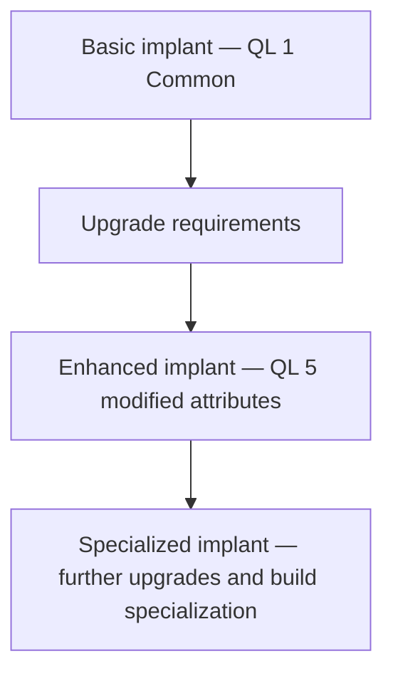

# Implant upgrade flow — concept draft

Reconstructed from owner-supplied conversation screenshots, 2026-11-19. Provisional, not a runtime asset.

Requirements: compatible base implant, specialized components, fabrication proficiency, relevant character skills, appropriate fabrication station. Quality and rarity are independent. See [progression illustration](implant-progression.svg). Both drafts derive from conversation concepts, not validated gameplay.
